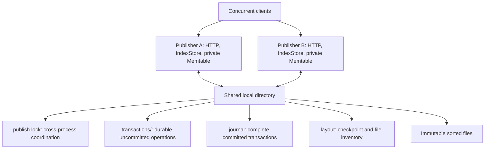

# Relive

Relive is a serverless index project for real-time lakehouses. The target is
concurrent reads and writes through replaceable compute instances, multiple
independent publishers, and cross-instance visibility after a durable commit.
Compute-local state may accelerate access; acknowledged data must survive the
loss of that compute instance. Millisecond updates and lookups are research
targets, with workload-specific latency and cost bounds still to be defined.

The current runnable prototype uses independent JVM publishers sharing a local
disk journal, atomic multi-index commits, and point/range reads of current or
retained committed state. Clients use loopback HTTP and never access the shared
directory. It does not yet provide a serverless deployment or remote storage.

The [architecture overview](docs/architecture.md) explains the components and
design choices. The [index service design contract](docs/index-service.md) records the agreed
requirements and separates them from implementation choices still under
discussion. The [local protocol](docs/local-protocol.md) describes the implemented
subset and its limits. It now has a bounded charged Memtable, immutable sorted
files, and explicit full-merge compaction. It is not a production lakehouse
integration or a scale-validated storage engine.

## Current architecture



Publishers serialize refresh and publication using the shared file lock. Each
publisher queues commits and publishes them in groups with one fsync per group;
a commit may name the previous queued commit as its parent. Reads use the latest
published local view without the lock unless the journal has grown, then merge
the pinned candidate files with the Memtable. Concurrent clients and independent
publishers are supported.

Memtable pressure freezes the Memtable for a background flush; commits wait only
while two frozen Memtables are queued. Flushes produce level-0 files; a
background compactor merges them into disjoint level-1 files once level 0 is
large enough. Level-1 files live in the store's `level1/` subdirectory, which may
be mounted on separate storage; everything else stays in the store directory.
Compaction merges its inputs outside the publication lock and
validates membership before replacement. The journal is retained without segment reclamation. These are
prototype mechanisms, not decisions about the final serverless architecture.

## Build and run

JDK 17, Maven, and a Linux local filesystem supporting file locks and file/directory
fsync are required. From this repository:

```bash
mvn package
mkdir -p build/services
java -jar build/relive.jar build/services/demo 7001
```

In a second terminal, start an independent publisher against the same directory:

```bash
java -jar build/relive.jar build/services/demo 7002
```

The directory's parent must exist. Each server binds to `127.0.0.1`; port `0`
selects an available port. The startup line prints the address. Stop each server
with Ctrl-C. These commands create local working state under `build/`.

Commit through the first server, then immediately read through the second:

```bash
curl --fail-with-body http://127.0.0.1:7001/commit \
  -H 'Content-Type: application/json' \
  -d '{"parent":"","id":"lake-41","changes":[{"index":"customers.pk","key":"00000001","value":"0000000a","delete":false}]}'
curl --fail-with-body http://127.0.0.1:7002/read \
  -H 'Content-Type: application/json' \
  -d '{"at":null,"scans":[{"index":"customers.pk","lower":"00000001","lowerInclusive":true,"upper":"00000001","upperInclusive":true,"descending":false,"limit":1}]}'
```

The read returns `at: "lake-41"` and the value `0000000a`. This example expects a
fresh demo directory. The next new commit must name `lake-41` as its parent.
Do not automatically rebase rejected requests onto a new parent.

## Tests

```bash
mvn test
```

The default suite includes separate JVM services on loopback sockets, concurrent
publishers, immediate cross-client visibility, historical/range results,
delete/reinsert behavior, forced process termination after acknowledgment,
reopening, and deliberately invalid requests and journal frames. It requires
permission to start local sockets. Tests use temporary directories and do not
contact COS, EFS, PostgreSQL, or a lakehouse.

For a storage-only diagnostic in a socket-restricted environment, use
`mvn -Dtest=IndexStoreTest test`; this does not replace the multi-process suite.

## SIBench integration

[SIBench](https://github.com/gengdy1545/SIBench) owns workload capture, Trace
interpretation, replay scheduling, reference results, and the adapter that
translates those calls to Relive's online protocol. Relive owns its engine,
publication protocol, storage, and correctness tests. The service does not read
or look ahead in Trace files.

A replay harness needs the complete published Trace directory, including the
baseline, workload, work-unit inventory, and manifests, plus matching reference
results. Proto-only input uses RowIDs. Loading an arbitrary key subset is not a
valid substitute for the complete initial state of a workload's range queries.

Integration requires a SIBench revision that supplies the matching adapter and
build entry point. This standalone repository does not guarantee that any given
SIBench branch includes them. Build and test Relive using the commands above;
consult that SIBench revision's own instructions before replay. When integrated
under `index/relive/`, external build artifacts belong under the parent checkout's
`build/index/relive/`; Relive's Maven output can be redirected with
`-Drelive.build.directory=/absolute/output/path`.

## Current limits

Publication, log catch-up, and memory-pressure flush use a global file lock;
there is no fixed publisher process, but these critical sections are serialized.
Both data versions and commit identities spill to sorted files. The checksummed
file inventory records per-index key bounds, allowing reads to skip disjoint
files while preserving old versions and tombstones. Each sorted file has a block
directory and a Bloom filter, kept in memory while the file is open, so a point
lookup skips files without its key and reads one block from the others. Reads at the refreshed
current head use its known internal revision; historical commit identities
still require lookup. Selection scans the descriptor list, so overlapping files
and large inventories remain capacity concerns. The default
Memtable charge limit is 4 MiB; set `-Drelive.memtable.bytes=262144` before `-jar`
for a 256 KiB diagnostic. `-Drelive.http.workers` sets the HTTP worker threads (default 4). This accounting bound is not an RSS limit: complete
request buffers, a transaction that crosses the threshold, merge cursors, file
inventories, and open files' block directories and filters require additional memory.

`POST /flush` persists the current Memtable. `POST /compact` merges all current
sorted files into level 1, preserving every version and tombstone; it does not flush
the tail implicitly. Call flush followed by compact to drain maintenance at a
measurement boundary. Merging runs outside the publication lock, then checks
that the selected inputs are still valid before publishing their replacement.
Background level-0 compaction has no separate backlog controller beyond its trigger.

`GET /stats` reports logical mutation bytes, journal bytes, sorted-file outputs,
compaction reads, Memtable charge, and file count. See the protocol for the exact
measurement boundaries. The file manifest is a physical checkpoint, not a
transactional Hudi-style metadata table. There is no COS backend, version GC,
exact-version relocation, or lakehouse commit adapter yet. Transaction-local
reads use shared durable staging; groups are materialized in memory. File inventories,
retained history, and merge fan-in still need capacity validation before 87m use.

Incomplete or corrupt journal frames fail closed and are retained; automatic
tail repair and power-loss recovery certification are not implemented. Local
journal fsync is the current acknowledgment persistence boundary, not COS
durability. See the local protocol for unknown commit outcomes and explicit
idempotent resubmission.

## Bounded publication diagnostic

After `mvn package` in this repository, use Python 3 to run the Java synthetic
workload through the orchestration script, with fresh output and state paths:

```bash
python3 scripts/probe_relive.py build/relive.jar build/test-classes \
  build/probe-results build/services/relive-probe --maintenance
```

It uses 512 keys, two indexes, and 512 commits, checks every immediate read and
the complete initial/final states, and records maintenance drain separately.
Servers have 256 MiB heaps and a 256 KiB Memtable charge threshold. Execution is
limited to 120 seconds and 1 GiB of local state, with a 20 GiB free-space preflight.
It samples aggregate server PSS and CPU on Linux. It is a serial closed-loop
protocol diagnostic, not HyBench/YCSB/sysbench replay or a throughput limit.

## Development

| Location | Responsibility |
| --- | --- |
| `docs/index-service.md` | Target requirements and unresolved external semantics |
| `docs/local-protocol.md` | Implemented requests, persistence, visibility, and limits |
| `src/main/java/org/relive/Protocol.java` | Request and response types and validation |
| `src/main/java/org/relive/IndexServer.java`, `IndexClient.java` | Local HTTP transport and client |
| `src/main/java/org/relive/IndexStore.java` | Publication, reads, replay, flush, and compaction |
| `src/main/java/org/relive/TransactionState.java` | Durable transaction staging |
| `src/main/java/org/relive/Layout.java`, `SortedRun.java` | Physical checkpoints and immutable sorted storage |
| `src/test/java/org/relive/` | Contract tests, process tests, and the synthetic probe |
| `scripts/probe_relive.py` | Bounded probe orchestration and resource sampling |
| `pom.xml` | Java build, dependencies, and executable JAR |

Keep maintained documentation and code comments in English. Organize future
source, tests, and configuration by responsibility. Keep generated output,
credentials, machine settings, and experiment records out of source commits.
Keep runnable instructions and correctness tests current with behavior changes.
Local plans, research comparisons, and experiment records belong in ignored
`develop/`; they are optional and must not become build or test dependencies.
