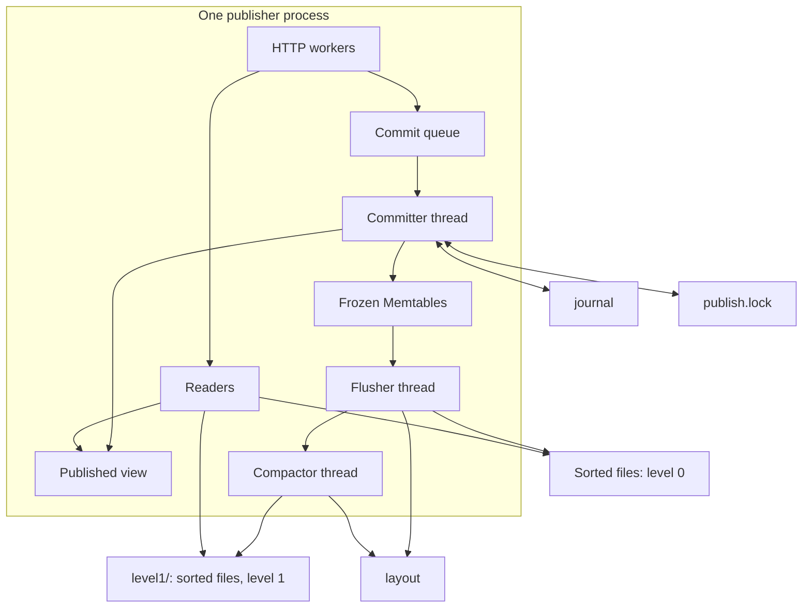

# Relive architecture

This document explains how the current prototype is organized and why. The
requirements it is measured against are in the
[index service design contract](index-service.md); the exact request semantics,
limits and failure behavior are in the [local protocol](local-protocol.md). When
the two documents and this overview disagree, those documents govern.

The prototype runs one or more publisher processes over one shared local
directory. It is a step toward a serverless index for real-time lakehouses, not
that system: there is no remote object storage, lease service or log reclamation.

## Overview

Every durable fact lives in the shared directory: the journal of complete
commits, the layout checkpoint and file inventory, the immutable sorted files,
staged transactions and the input binding. A process holds only state it can
rebuild from those files: its Memtables, its published view, and open file
handles with their block directories and Bloom filters.

## Data model

An entry is a row `(index, key, revision)` with a value or a tombstone, the
commit identity that wrote it, and a row identity used to combine scans.
Revisions are internal ordinals assigned in journal order; callers name read
points by commit identity. A read at a point returns, for each key, the newest
revision at or below that point unless it is a tombstone. All versions are
retained. The reserved empty index stores commit-identity records (used to
reject a reused identifier and to resolve historical read points) and
transaction-publication receipts; it shares files and lookup paths with data.

## Write path

1. A client calls `commitAsync`, which serializes the commit on the caller's
   thread and appends it to the process's commit queue.
2. One committer thread takes the queued commits, up to 64 MiB, as a group.
   Under the publication lock it catches up on frames written by other
   processes, then validates each commit in queue order: a reused identifier
   must repeat the same request, and the parent must be the current head or the
   previous accepted commit of the same group. A rejected commit rejects every
   later commit that names it.
3. The group's frames are written with one call and forced with one fsync, then
   installed in the active Memtable, and a new view is published.
4. Only then do the acknowledgments complete. An acknowledged commit is durable
   and visible to every read that starts afterwards.

Grouping amortizes the fsync across concurrent commits; the lock covers only
validation, one write and one fsync, so readers and later submitters are not
serialized behind each other.

## Read path

A published view is immutable: head, revision, layout, the active Memtable and
the frozen Memtables. A read first compares the journal length with the length
this process has written, including frames of a group it is still writing. If
the journal is no longer, no other process has published since, and the read
uses the current view without any lock. Otherwise, and for reads
inside a staged transaction, it takes the lock and catches up first.

For each scan the read selects files whose per-index key bounds overlap it and,
for a point scan, whose Bloom filter may contain the key; it pins only those
files and merges ordered cursors over the Memtables and them. Rows newer than
the view's revision are ignored, so a group still being installed is never
visible. A file that a newer layout already replaced makes a lock-free read
retry under the lock.

## Journal and layout

The journal holds two frame types: complete commits, and layout markers. Every
flush or compaction saves a new layout and then appends a marker naming its
generation, before any replaced file is deleted. The journal length is therefore
the single progress signal: an unchanged length means there is nothing to replay
and the cached layout is current, so the layout file is reloaded only after the
journal grows. A process steps over the markers it appends itself.

The layout records the checkpoint (covered journal position, revision, head,
statistics) and the file inventory. Each file entry carries its level, length
and exact key bounds for every index it contains, including tombstones and old
versions, so bounds-based pruning is safe for historical reads.

## Sorted files

A sorted file stores rows in blocks of about 16 KiB. Each block holds its rows,
their offsets and a CRC32C. A footer locates the block directory (offset,
length, row count and first key of every block) and a Bloom filter over every
key in the file, with a checksum of its own. The filter keeps each key's probes
in one 512-bit block, so a check costs one cache miss. A lookup binary-searches the
directory, reads one block and binary-searches its offsets, decoding only the
rows it compares. A process keeps each file it has read open, together with its
directory and filter, until the file leaves the layout; readers hold a
reference so a file closed by a layout change stays usable until they finish.

## Memtables, flush and backpressure

When a group fills the active Memtable, it is frozen and an empty Memtable takes
later commits. A background flusher writes the oldest frozen Memtable to a
level-0 file outside the lock, then reloads the layout under the lock and
installs the file only if that Memtable is still the next checkpoint. If another
process already flushed those journal bytes, the file is discarded. While two
frozen Memtables wait, new groups wait too; this is the only write
backpressure. An explicit flush, and Memtable pressure while replaying the
journal, flush synchronously under the lock.

## Compaction

Level-0 files come from flushes and may overlap. Level-1 files have disjoint
key ranges, and every version of a key stays in one file; the layout rejects
overlapping level-1 files. After a flush is installed, if level 0 has at least
four files holding a tenth of level 1's bytes, or eight files, a background
compactor merges level 0 with the level-1 files its range overlaps. Output files
of about 256 MiB end at key boundaries. Inputs are selected under the lock but
opened and merged outside it. Before replacing its inputs, the compactor checks
they are still in the layout; a compaction that lost a race
discards its outputs. Replaced files are deleted after the lock is released.

Level-1 files live in a `level1/` subdirectory and everything else stays in the
store directory. The journal, layout and level-0 files are small, change often
and need appends, fsync and atomic rename, so they belong on shared file storage.
Level-1 files are large, immutable and rewritten only by compaction, so that
directory can sit on cheaper storage. They are only created, read by offset and
deleted, which object storage also supports.

With hash-distributed keys every level-1 file overlaps level 0, so each merge
rewrites level 1; the size trigger bounds the rewritten bytes to about ten times
the flushed bytes. A multi-level policy would lower this cost.

## Multiple publishers

Every process can commit. The OS file lock serializes journal catch-up and
append across processes; each process replays every commit into its own
Memtables. Any process may flush or compact; the checkpoint and membership
checks make the first publication win and the others discard their work. A read
that starts after another process acknowledged a commit sees the journal grow
and catches up before answering.

## Staged transactions and binding

Multi-operation transactions are staged as durable per-transaction files that
any process can extend, read through, and publish as one complete commit with a
durable receipt. The binding file ties the index to one input. See the
[local protocol](local-protocol.md#staged-transactions-and-binding).

## Design choices and their sources

- **The log is the source of truth.** Memtables, views, file handles and filters
  are derived and rebuildable. Boki's shared log separates ordering and read
  consistency through its metalog, and its function nodes serve reads from a
  local index that has caught up to a required position; Relive's journal length
  plays the role of that position, and the published view is the local index.
- **Metadata changes are logged.** OceanBase Bacchus writes storage metadata
  changes to a shared log that read-only nodes replay instead of rereading
  shared metadata. Relive appends a layout marker for every inventory change, so
  readers reload the inventory only when it changed.
- **Batch the durable step.** Grouping commits per fsync and accepting a parent
  that is not yet durable follow the batching and pipelining used by
  consensus-backed logs such as Bacchus's PALF.
- **Keep maintenance off the foreground path.** Flush and compaction run in
  background threads and publish atomically; the foreground waits only for
  explicit backpressure. Bacchus reports foreground write stalls in HBase when
  flushing could not keep up, which is why the backpressure bound is explicit.
- **Per-file indexes over a separate metadata table.** Relive writes its own
  files, so block directories and Bloom filters live in each file's footer and
  are cached by immutable file name; the shared layout keeps only per-file key
  bounds, levels and lengths. This differs from a lakehouse metadata table
  such as Hudi's, which exists because those systems index files they do not
  format.
- **Considered and not adopted yet:** one leader per log partition with
  cross-partition two-phase commit (Bacchus), lease-protected storage writers,
  and server-assigned commit order. Each changes the commit or failure semantics
  and needs its own decision.

## Current limits

- One shared local directory, with `level1/` possibly mounted elsewhere, and OS file locks; no remote storage, fencing or
  lease-based ownership; not certified on EFS or object storage.
- One committer thread per process bounds commit throughput; HTTP commits are
  not pipelined.
- Rows are encoded as JSON and revalidated when decoded, which dominates read
  and compaction CPU.
- A single compacted level rewrites all of it for hash-distributed keys.
- Open files, their directories and filters are cached without a bound and are
  not counted in the Memtable charge.
- No journal reclamation, garbage collection of old versions, or orphan-file
  collection.

## References

- Zhipeng Jia and Emmett Witchel. Boki: Stateful Serverless Computing with
  Shared Logs. SOSP 2021. <https://doi.org/10.1145/3477132.3483541>
- Quanqing Xu et al. OceanBase Bacchus: a High-Performance and Scalable
  Cloud-Native Shared Storage Architecture for Multi-Cloud. PVLDB 20(1), 2026.
  <https://arxiv.org/abs/2602.23571>
